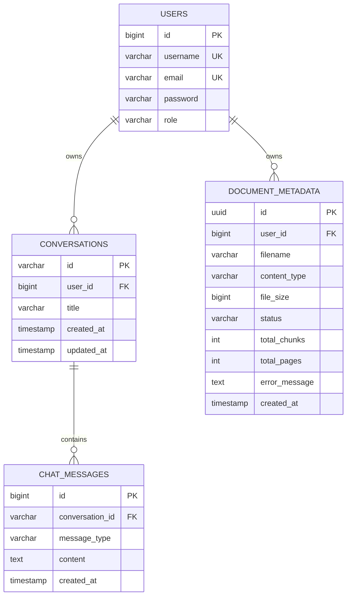

<h1 align="center">
  
</h1>

<p align="center">
  <strong>An intelligent, full-stack RAG (Retrieval-Augmented Generation) platform for document Q&A, semantic search, and AI-powered chat with persistent memory.</strong>
</p>

<p align="center">
  
  
  
  
  
  
  
  
  
</p>

---

## 📋 Table of Contents

- [Overview](#-overview)
- [Architecture](#-architecture)
- [Tech Stack](#-tech-stack)
- [Features](#-features)
- [Project Structure](#-project-structure)
- [Database Schema](#-database-schema)
- [API Reference](#-api-reference)
- [Getting Started](#-getting-started)
  - [Prerequisites](#prerequisites)
  - [Backend Setup](#backend-setup)
  - [Frontend Setup](#frontend-setup)
- [Configuration](#-configuration)
- [RAG Pipeline](#-rag-pipeline)
- [Chat Memory Architecture](#-chat-memory-architecture)
- [Security](#-security)
- [Contributing](#-contributing)

---

## 🧠 Overview

**DocMind** is a production-ready, full-stack AI document intelligence application that combines the power of **Retrieval-Augmented Generation (RAG)** with **persistent conversational memory** to provide deeply context-aware answers grounded in your uploaded documents.

Upload any document (PDF, DOCX, TXT, MD, CSV), ask questions about it, and get accurate AI responses with page-level citations — all while maintaining multi-turn conversation history backed by PostgreSQL.

### What makes DocMind different?

| Feature | DocMind |
|---|---|
| **User-Isolated RAG** | Every user's documents and vector embeddings are completely isolated via metadata filtering |
| **Persistent Chat Memory** | Conversations persist across sessions in PostgreSQL via a custom `JpaChatMemory` implementation |
| **Streaming Responses** | Real-time token streaming via Server-Sent Events (SSE) |
| **Granular Citations** | Every AI answer includes source file name, page number, chunk index, and similarity score |
| **JWT Authentication** | Stateless, role-based security with JWT tokens |
| **Swagger UI** | Full OpenAPI 3 documentation auto-generated for all endpoints |

---

## 🏗️ Architecture

```
┌────────────────────────────────────────────────────────────────────────────┐
│                          DocMind System Architecture                       │
└────────────────────────────────────────────────────────────────────────────┘

  ┌──────────────────┐         ┌──────────────────────────────────────────┐
  │   React Frontend │         │            Spring Boot Backend           │
  │  (Vite + TS)     │──HTTP──▶│                                          │
  │                  │◀──SSE───│  ┌──────────┐  ┌────────┐  ┌─────────┐  │
  │  • ChatView      │         │  │AuthCtrl  │  │DocCtrl │  │ChatCtrl │  │
  │  • SearchView    │         │  └────┬─────┘  └───┬────┘  └────┬────┘  │
  │  • Sidebar       │         │       │              │            │       │
  │  • UploadDialog  │         │  ┌────▼─────────────▼────────────▼────┐  │
  └──────────────────┘         │  │              Services               │  │
                               │  │  UserService  DocumentIngestion     │  │
                               │  │  RagService   JpaChatMemory         │  │
                               │  └──────────────────┬─────────────────┘  │
                               └─────────────────────┼─────────────────────┘
                                                      │
                          ┌───────────────────────────┼──────────────────────┐
                          │                     PostgreSQL                   │
                          │  ┌────────────┐  ┌──────────────┐  ┌─────────┐  │
                          │  │   users    │  │ conversations │  │pgvector │  │
                          │  │ doc_meta   │  │ chat_messages │  │  store  │  │
                          │  └────────────┘  └──────────────┘  └─────────┘  │
                          └──────────────────────────────────────────────────┘
                                                      │
                                         ┌────────────▼──────────┐
                                         │      OpenAI API        │
                                         │  text-embedding-*      │
                                         │  gpt-4o / gpt-4-turbo  │
                                         └───────────────────────┘
```

---

## ⚙️ Tech Stack

### Backend

| Technology | Version | Purpose |
|---|---|---|
| Java | 21 | Core language |
| Spring Boot | 4.1.0 | Application framework |
| Spring AI | 2.0.0 | AI/RAG orchestration |
| Spring Security | Latest | Auth & authorization |
| Spring Data JPA | Latest | ORM & database layer |
| JJWT | 0.13.0 | JWT token generation/validation |
| PostgreSQL | 16 | Relational data & vector store |
| pgvector | Latest | Vector similarity search |
| Apache Tika | via Spring AI | Multi-format document parsing |
| Lombok | Latest | Boilerplate reduction |
| ModelMapper | 3.2.4 | DTO mapping |
| SpringDoc OpenAPI | 3.1.0 | Swagger UI & API docs |

### Frontend

| Technology | Version | Purpose |
|---|---|---|
| React | 19 | UI framework |
| TypeScript | 6.0 | Type safety |
| Vite | 8.2.0 | Build tool & dev server |
| TailwindCSS | 4.3.3 | Styling |
| Zustand | 5.0.15 | State management |
| Framer Motion | 13.1.0 | Animations |
| Axios | 1.19.0 | HTTP client |
| React Router | 7.18.2 | Client-side routing |
| React Markdown | 10.1.0 | Markdown rendering |
| React Dropzone | 20.1.1 | File upload UX |
| Lucide React | 1.33.0 | Icon library |
| React Hot Toast | 2.6.0 | Notifications |

### Infrastructure

| Technology | Purpose |
|---|---|
| Docker Compose | Local development orchestration |
| pgvector/pgvector:pg16 | PostgreSQL with vector extension |

---

## ✨ Features

### 🔐 Authentication & Authorization

- **JWT-based stateless authentication** — no server-side session storage
- **Role-based access control** (USER / ADMIN roles)
- User registration and login with BCrypt password hashing
- Protected API routes with Spring Security filter chain
- Admin-only endpoints (e.g., list all system documents)

### 📄 Document Management

- **Multi-format upload support**: PDF, DOCX, TXT, Markdown, CSV
- Single and **bulk document upload** endpoints
- Document status lifecycle: `PENDING → PROCESSING → INDEXED / FAILED`
- Document metadata stored in PostgreSQL (filename, content type, size, chunk count, page count)
- Delete document and **automatically purge all vector embeddings** from pgvector

### 🤖 AI Chat (RAG)

- **Semantic Q&A** — questions answered using retrieved document chunks as context
- **Scope control** — ask against all user documents or a specific document by ID
- **Configurable `topK`** and `minSimilarity` threshold per request
- **Citation-enriched responses** — every answer includes source file, page number, chunk index, and similarity score
- **Streaming mode** — real-time SSE token streaming via `/api/v1/chat/stream`
- Fallback to general knowledge when no relevant document context is found

### 💬 Persistent Conversation Memory

- Multi-turn conversations with full history stored in PostgreSQL
- Custom `JpaChatMemory` implementation integrates natively with Spring AI's `MessageChatMemoryAdvisor`
- Last N messages retrieved per conversation to maintain context window efficiency
- List, retrieve, and delete conversation threads via REST API
- Conversations auto-named from first user prompt (truncated at 50 chars)

### 🔍 Semantic Similarity Search

- Standalone vector search endpoint (without full LLM inference)
- Filter by user scope and optional document ID
- Returns matched chunks with metadata and cosine similarity scores

### 🛡️ User-Level Document Isolation

- Every vector chunk is tagged with `userId` metadata at ingestion time
- All similarity searches apply a `userId` filter expression — users **cannot** query each other's documents
- Conversation ownership is enforced at the repository level

---

## 📁 Project Structure

```
docmind-rag-based-project/
│
├── src/main/java/com/substring/docmind/
│   ├── DocmindBackendApplication.java      # Spring Boot entry point
│   ├── config/
│   │   ├── AppProperties.java              # Typed config properties (RAG params, CORS)
│   │   ├── CorsConfig.java                 # CORS configuration
│   │   ├── JwtAuthenticationFilter.java    # JWT request filter
│   │   ├── ProjectConfig.java              # ChatClient + MessageChatMemoryAdvisor setup
│   │   └── SecurityConfig.java             # Spring Security filter chain
│   ├── controller/
│   │   ├── AuthController.java             # POST /api/v1/auth/login, /register
│   │   ├── ChatController.java             # POST /api/v1/chat/query, /stream, /search/similarity
│   │   └── DocumentController.java         # POST/GET/DELETE /api/v1/documents
│   ├── service/
│   │   ├── RagService.java                 # Core RAG logic: retrieve → augment → generate
│   │   ├── DocumentIngestionService.java   # Chunking, metadata enrichment, vector store write
│   │   ├── DocumentMetadataService.java    # Document CRUD with user scope
│   │   ├── DocumentParserService.java      # Tika-based multi-format parsing
│   │   ├── JpaChatMemory.java              # Spring AI ChatMemory backed by PostgreSQL
│   │   ├── JwtService.java                 # JWT generation and validation
│   │   ├── UserService.java                # User registration
│   │   ├── CustomUserDetail.java           # Spring Security UserDetails adapter
│   │   └── CustomUserDetailService.java    # UserDetailsService implementation
│   ├── entity/
│   │   ├── User.java                       # User entity
│   │   ├── DocumentMetadata.java           # Tracks uploaded documents and indexing status
│   │   ├── Conversation.java               # Conversation thread (belongs to User)
│   │   ├── ChatMessage.java                # Individual message in a conversation
│   │   ├── DocumentStatus.java             # Enum: PENDING, PROCESSING, INDEXED, FAILED
│   │   ├── MessageType.java                # Enum: USER, ASSISTANT, SYSTEM
│   │   └── Role.java                       # Enum: USER, ADMIN
│   ├── dto/                                # Request/Response DTOs
│   ├── repository/                         # Spring Data JPA repositories
│   └── exception/                          # Custom exception classes
│
├── frontend/
│   ├── docmind-frontend/                   # React + TypeScript frontend
│   │   ├── src/
│   │   │   ├── components/
│   │   │   │   ├── ChatView.tsx            # Main chat interface with SSE streaming
│   │   │   │   ├── ChatsPanel.tsx          # Conversation history panel
│   │   │   │   ├── ChunksView.tsx          # Document chunks viewer
│   │   │   │   ├── SearchView.tsx          # Semantic similarity search UI
│   │   │   │   ├── Sidebar.tsx             # Navigation sidebar with document list
│   │   │   │   ├── UploadDialog.tsx        # Drag & drop file upload modal
│   │   │   │   ├── Navbar.tsx              # Top navigation bar
│   │   │   │   ├── ProtectedRoute.tsx      # Auth guard component
│   │   │   │   └── ErrorBoundary.tsx       # Error boundary component
│   │   │   ├── pages/
│   │   │   │   ├── Login.tsx
│   │   │   │   └── Register.tsx
│   │   │   ├── services/                   # Axios API service layer
│   │   │   ├── store/                      # Zustand state stores
│   │   │   └── types/                      # TypeScript type definitions
│   │   └── package.json
│   └── screenshots/                        # UI screenshots
│
├── docs/
│   ├── CHAT_MEMORY_DB_ARCHITECTURE.md      # Detailed chat memory design doc
│   ├── USER_DOCUMENT_ISOLATION_ANALYSIS.md # User isolation analysis
│   └── FRONTEND_BUILD_PROMPT.md
│
├── docker-compose.yml                      # PostgreSQL + pgvector service
├── init.sql                                # DB init: vector + uuid-ossp extensions
└── pom.xml                                 # Maven dependencies
```

---

## 🗄️ Database Schema



---

## 📡 API Reference

> Full interactive documentation: **`http://localhost:8080/swagger-ui.html`**

### Auth — `/api/v1/auth`

| Method | Endpoint | Description | Auth |
|---|---|---|---|
| `POST` | `/login` | Login and receive JWT token | No |
| `POST` | `/register` | Register a new user account | No |

### Documents — `/api/v1/documents`

| Method | Endpoint | Description | Auth |
|---|---|---|---|
| `POST` | `/upload` | Upload and index a single document | JWT |
| `POST` | `/upload-multiple` | Upload and index multiple documents | JWT |
| `GET` | `/user` | List all documents of the logged-in user | JWT |
| `GET` | `/` | List all documents (**Admin only**) | Admin |
| `GET` | `/{id}` | Get document metadata by ID | JWT |
| `DELETE` | `/{id}` | Delete document and purge vectors | JWT |

### Chat — `/api/v1/chat`

| Method | Endpoint | Description | Auth |
|---|---|---|---|
| `POST` | `/query` | Ask a question (blocking, with citations) | JWT |
| `POST` | `/stream` | Stream a response via SSE | JWT |
| `POST` | `/search/similarity` | Raw semantic similarity search | JWT |

#### Chat Query Request

```json
POST /api/v1/chat/query
Authorization: Bearer <jwt_token>

{
  "question": "What are the key findings in the Q3 financial report?",
  "conversationId": "550e8400-e29b-41d4-a716-446655440000",
  "documentId": "a3f1c2b4-...",
  "topK": 5,
  "minSimilarity": 0.7
}
```

#### Chat Query Response

```json
{
  "success": true,
  "data": {
    "answer": "According to the Q3 financial report, the key findings include...",
    "conversationId": "550e8400-e29b-41d4-a716-446655440000",
    "responseTimeMs": 1823,
    "citations": [
      {
        "documentId": "a3f1c2b4-...",
        "fileName": "Q3_Report.pdf",
        "pageNumber": 4,
        "chunkIndex": 12,
        "snippet": "...revenue grew by 23% year-over-year...",
        "similarityScore": 0.89
      }
    ]
  },
  "timestamp": "2026-08-08T17:21:41"
}
```

---

## 🚀 Getting Started

### Prerequisites

- **Java 21** — [Download](https://adoptium.net/)
- **Maven 3.9+** (or use the included `./mvnw` wrapper)
- **Node.js 20+** & **npm**
- **Docker** & **Docker Compose**
- **OpenAI API Key** — [Get one here](https://platform.openai.com/api-keys)

---

### Backend Setup

**1. Clone the repository**

```bash
git clone https://github.com/your-username/docmind-rag-based-project.git
cd docmind-rag-based-project
```

**2. Start PostgreSQL with pgvector**

```bash
docker compose up -d
```

This spins up PostgreSQL 16 with `pgvector` and `uuid-ossp` extensions on port **5434**.

**3. Configure `application.properties`**

Create `src/main/resources/application.properties`:

```properties
# Server
server.port=8080

# PostgreSQL Datasource
spring.datasource.url=jdbc:postgresql://localhost:5434/docmind
spring.datasource.username=postgres
spring.datasource.password=postgres
spring.datasource.driver-class-name=org.postgresql.Driver

# JPA / Hibernate
spring.jpa.hibernate.ddl-auto=update
spring.jpa.show-sql=false
spring.jpa.properties.hibernate.dialect=org.hibernate.dialect.PostgreSQLDialect

# OpenAI
spring.ai.openai.api-key=sk-YOUR_OPENAI_API_KEY
spring.ai.openai.chat.options.model=gpt-4o
spring.ai.openai.embedding.options.model=text-embedding-3-small

# PgVector Store
spring.ai.vectorstore.pgvector.index-type=HNSW
spring.ai.vectorstore.pgvector.distance-type=COSINE_DISTANCE
spring.ai.vectorstore.pgvector.dimensions=1536
spring.ai.vectorstore.pgvector.initialize-schema=true

# JWT
app.jwt.secret=YOUR_BASE64_ENCODED_SECRET_KEY_AT_LEAST_256_BITS
app.jwt.expiration=86400000

# RAG Tuning
app.rag.chunk-size=600
app.rag.min-chunk-size-chars=350
app.rag.min-chunk-length-to-embed=5
app.rag.max-num-chunks=10000
app.rag.top-k=5
app.rag.similarity-threshold=0.0

# CORS
app.cors.allowed-origins=http://localhost:5173
app.cors.allowed-methods=GET,POST,PUT,DELETE,OPTIONS
app.cors.allowed-headers=*

# File Upload
spring.servlet.multipart.max-file-size=50MB
spring.servlet.multipart.max-request-size=50MB
```

**4. Run the backend**

```bash
./mvnw spring-boot:run
```

- Backend: **http://localhost:8080**
- Swagger UI: **http://localhost:8080/swagger-ui.html**

---

### Frontend Setup

```bash
cd frontend/docmind-frontend
npm install
```

Create a `.env` file:

```env
VITE_API_BASE_URL=http://localhost:8080
```

Start the dev server:

```bash
npm run dev
```

Frontend: **http://localhost:5173**

---

## ⚙️ Configuration

### RAG Tuning Parameters (`app.rag.*`)

| Property | Default | Description |
|---|---|---|
| `chunk-size` | `600` | Max tokens per document chunk |
| `min-chunk-size-chars` | `350` | Min characters required to form a chunk |
| `min-chunk-length-to-embed` | `5` | Min chars for a chunk to be embedded |
| `max-num-chunks` | `10000` | Max chunks per document |
| `top-k` | `5` | Default number of similar chunks to retrieve |
| `similarity-threshold` | `0.0` | Minimum cosine similarity score (0 = no filter) |

> `topK` and `minSimilarity` can be overridden **per request** in the `ChatRequestDto` body.

---

## 🔄 RAG Pipeline

```
Document Upload
      │
      ▼
 DocumentParserService (Apache Tika / PDF Reader)
      │  → Parsed pages as Spring AI Documents
      ▼
 DocumentIngestionService
      ├─► TokenTextSplitter      → Splits into chunks (default: 600 tokens)
      ├─► Metadata Enrichment    → Adds: documentId, fileName, userId,
      │                            chunkIndex, pageNumber, contentType
      └─► VectorStore.add()      → Generates embeddings (OpenAI text-embedding-3-small)
                                   Stores vectors in PostgreSQL pgvector table

User Query
      │
      ▼
 RagService.askQuestion()
      ├─► VectorStore.similaritySearch()
      │     → Filters by userId (+ optional documentId)
      │     → Returns top-K most similar chunks
      ├─► buildContextString()
      │     → Formats chunks with [Source: file | Page: N] headers
      ├─► ChatClient.prompt()
      │     → System: DocMind persona + document context
      │     → User: original question
      │     → Advisor: MessageChatMemoryAdvisor (reads/writes DB chat history)
      │     → Calls OpenAI Chat Completion API
      └─► ChatResponseDto
            → answer, conversationId, citations[], responseTimeMs
```

---

## 💾 Chat Memory Architecture

DocMind implements a custom `JpaChatMemory` satisfying Spring AI's `ChatMemory` interface for database-backed conversational persistence:

```
RagService.askQuestion(request, user)
      │
      ├─► ensureConversationExists()   ← Creates Conversation row if new
      │
      └─► chatClient.prompt()
              .advisors(ChatMemory.CONVERSATION_ID = conversationId)
                    │
                    ▼
          MessageChatMemoryAdvisor
                    │
           ┌────────┴────────┐
           ▼                 ▼
  JpaChatMemory.get()   JpaChatMemory.add()
  (read last-N msgs)    (persist new msgs)
           │                 │
           └────────┬────────┘
                    ▼
             PostgreSQL — chat_messages table
```

**Key properties:**
- **Thread-safe** — scoped by `conversationId`
- **Efficient** — retrieves only last N messages
- **Consistent** — chronologically ordered before prompt injection
- **Resilient** — auto-creates conversation if ID missing

For the full design, see [`docs/CHAT_MEMORY_DB_ARCHITECTURE.md`](docs/CHAT_MEMORY_DB_ARCHITECTURE.md).

---

## 🔒 Security

### JWT Authentication Flow

```
Client                            Backend
  │                                  │
  │  POST /api/v1/auth/login         │
  │─────────────────────────────────▶│
  │                                  │── Authenticate credentials
  │                                  │── Generate JWT (HS256)
  │◀─────────────────────────────────│
  │  { "token": "eyJ..." }           │
  │                                  │
  │  Any protected request           │
  │  Authorization: Bearer eyJ...   │
  │─────────────────────────────────▶│
  │                                  │── JwtAuthenticationFilter validates
  │                                  │── Sets SecurityContextHolder
  │                                  │── Controller executes
  │◀─────────────────────────────────│
  │  Response data                   │
```

### Security Highlights

| Config | Value |
|---|---|
| Public endpoints | `/api/v1/auth/**`, `/swagger-ui/**`, `/v3/api-docs/**` |
| Protected endpoints | All `/api/v1/**` — require valid JWT |
| Admin-only | `GET /api/v1/documents` — requires `ROLE_ADMIN` |
| User isolation | `userId` filter on all vector queries |
| CSRF | Disabled (stateless REST) |
| Session policy | `STATELESS` |

---

## 🤝 Contributing

1. **Fork** the repository
2. **Create** a branch: `git checkout -b feature/my-feature`
3. **Commit**: `git commit -m 'feat: add my feature'`
4. **Push**: `git push origin feature/my-feature`
5. **Open** a Pull Request

### Commit Convention ([Conventional Commits](https://www.conventionalcommits.org/))

| Prefix | Purpose |
|---|---|
| `feat:` | New features |
| `fix:` | Bug fixes |
| `docs:` | Documentation |
| `refactor:` | Code refactoring |
| `chore:` | Build / config |
| `test:` | Tests |

---

## 📄 License

This project is licensed under the **MIT License**.

---

<p align="center">Built with ❤️ using Spring AI, React, and pgvector</p>
